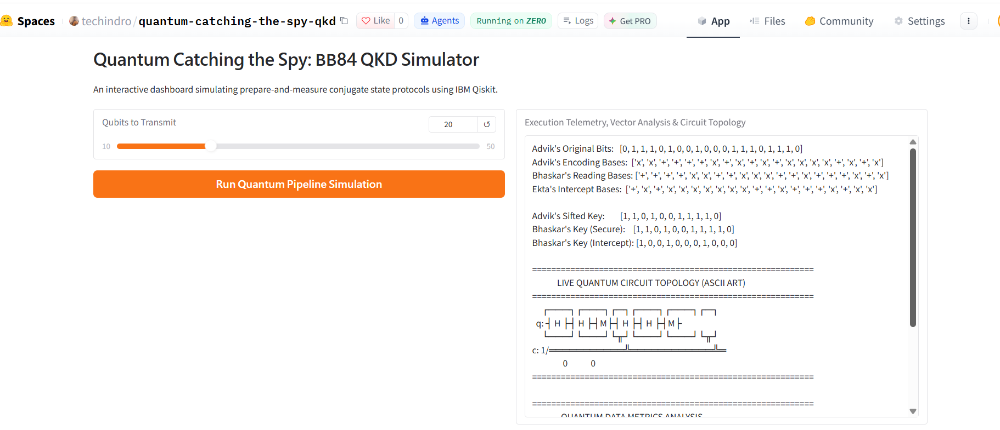
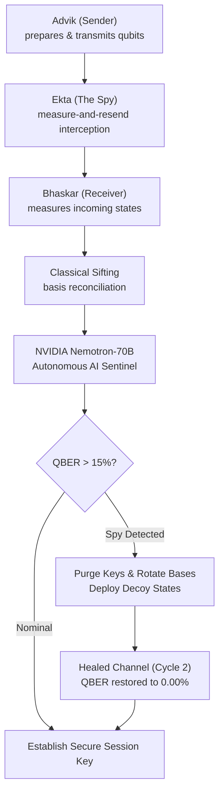
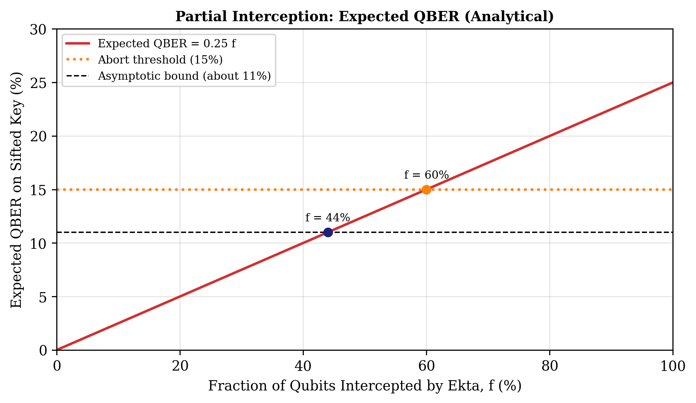
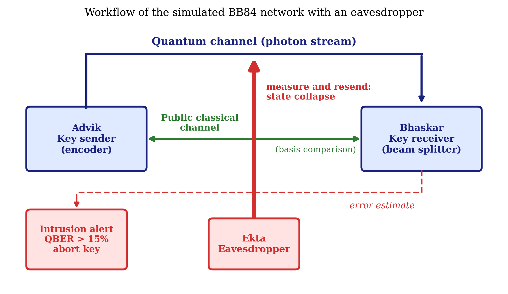
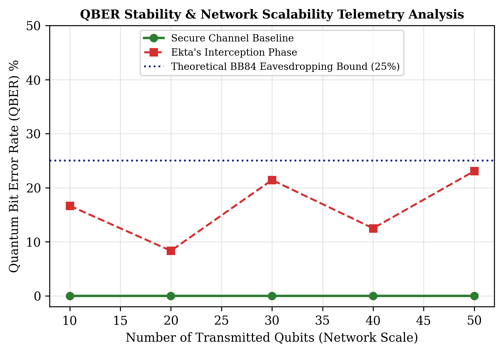
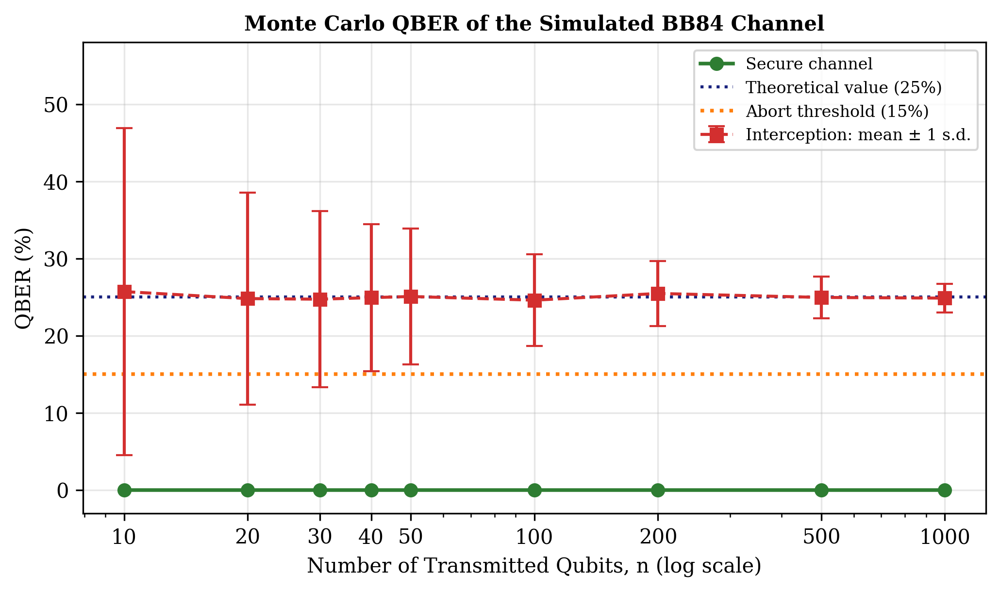
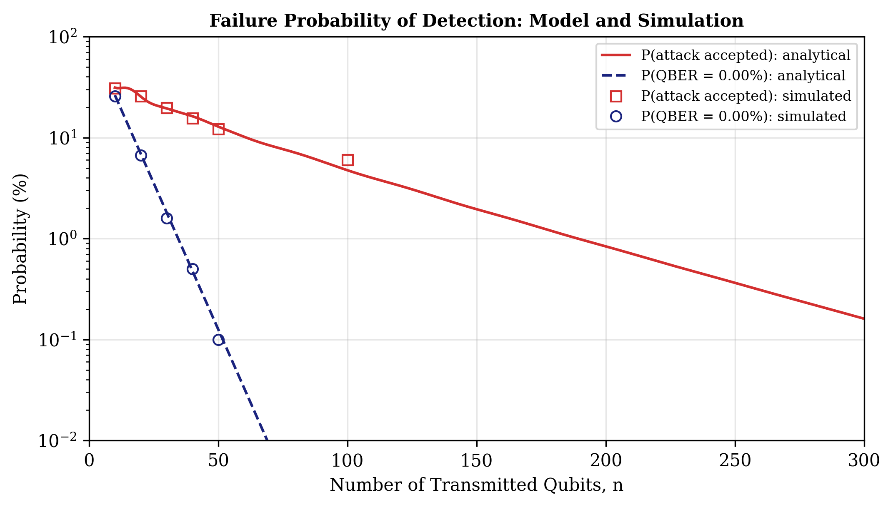
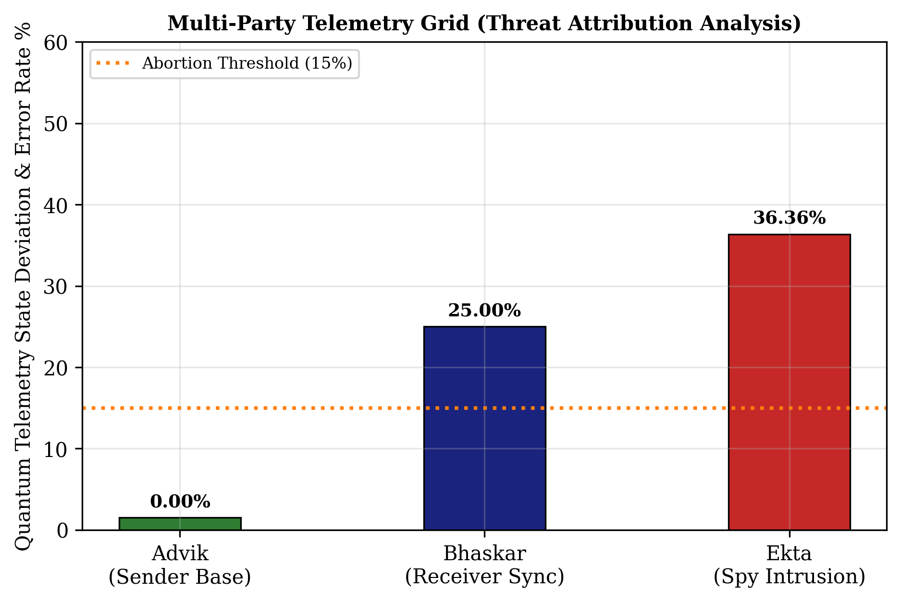

# Quantum-catching-the-spy-qkd

### Catching the Spy: Eavesdropper Detection and Autonomous Self-Healing in BB84 Quantum Key Distribution Networks Using IBM Qiskit and NVIDIA AI Sentinel

This repository simulates the BB84 protocol on a single-qubit circuit model. It features an autonomous closed-loop security architecture: an active eavesdropping attack by a spy ("Ekta") is simulated via IBM Qiskit, detected through real-time Quantum Bit Error Rate (QBER) telemetry,evaluated by NVIDIA Llama-3.1-Nemotron-70B on the cloud, and autonomously neutralized through dynamic basis rotation and decoy state isolation.

The four entities in the network:

| Name | Role | What they do |
|------|------|--------------|
| Advik | Sender | Picks random bits and random bases, and encodes them as conjugate qubits |
| Bhaskar | Receiver | Measures each incoming qubit in a randomly chosen basis |
| Ekta | The Spy | Intercepts qubits in transit via a Measure-and-Resend attack |
| NVIDIA Nemotron | AI Sentinel | Evaluates real-time telemetry, attributes threats, and triggers autonomous channel healing |

## Contents 

- [Live demo](#live-demo)
- [Paper](#paper)
- [Background](#background)
- [How the pieces fit together](#how-the-pieces-fit-together)
- [Autonomous Security Layer (NVIDIA Nemotron Integration)](#autonomous-security-layer-nvidia-nemotron-integration)
- [Installation](#installation)
- [Usage](#usage)
- [Paper figures: `BB84_paper_figures.ipynb`](#paper-figures)
- [What the simulation does](#what-the-simulation-does)
- [Expected results](#expected-results)
- [Limitations](#limitations)
- [Future work](#future-work)
- [References](#references)
- [License](#license)

## Live demo

You can try the simulation in the browser, without installing anything, on Hugging Face Spaces:

<https://huggingface.co/spaces/techindro/quantum-catching-the-spy-qkd>



## Paper

The full paper that describes this work is included in the repository:

**[Catching the Spy: Eavesdropper Detection Analysis in Quantum Key Distribution Networks Using Qiskit](paper/QKD_BB84_Research_Paper.pdf)** (PDF)

The MIT License of this repository covers the code. The text and figures of the paper are not covered by it.

## Background

BB84 is a quantum key distribution protocol published by Charles Bennett and Gilles Brassard in 1984. Two people use it to agree on a secret key, even though the qubits travel over a channel that someone else might be watching.

It works because of two facts about quantum states. First, an unknown state cannot be copied exactly (the no-cloning theorem), so a spy cannot keep a perfect copy and also pass the original along. Second, measuring a qubit in the wrong basis changes it, so the spy leaves traces behind.

Qubits are sent in one of two bases, written `+` (computational) and `x` (diagonal). If the sender and receiver happen to choose the same basis, the receiver reads the right bit. If they choose differently, the result is a coin flip. Afterwards they announce their bases in public, without revealing the bits, and keep only the positions where the bases matched. What is left is called the sifted key.

If a spy has been measuring, about one in four of the sifted bits will be wrong. Without a spy, in an ideal channel, none will be.

## How the pieces fit together



There are four steps:

1. Advik makes random bits and random bases, and prepares one qubit per bit.
2. Bhaskar measures each qubit in a random basis. In the attack run, Ekta measures first and resends.
3. Advik and Bhaskar compare their bases over the public channel and keep the matching positions.
4. They compare part of the sifted key, work out the QBER, and decide whether to keep or discard it.

## Installation

You need Python 3.10 or newer.

```bash
git clone https://github.com/techindro/quantum-catching-the-spy-qkd.git
cd quantum-catching-the-spy-qkd

python -m venv venv
source venv/bin/activate        # on Windows: venv\Scripts\activate

pip install -r requirements.txt
```

## Usage

Run the simulation from the repository root:

```bash
python bb84_sim.py            # full Monte Carlo of the paper (takes several minutes)
python bb84_sim.py --quick    # a few runs per n, only to check that the setup works
```

It prints the mean QBER, the standard deviation and the abort rate for every number of transmitted qubits, and writes two CSV files to a `results/` folder:

- `monte_carlo_runs.csv`, one row per session (secure and attacked channel)
- `table_x_summary.csv`, the summary per n used in Table X of the paper

To run the small test file (secure channel gives 0% QBER, attack gives about 25%):

```bash
python tests/test_bb84.py
```

The exact library versions used in the paper are listed in `requirements-paper.txt`.

## Paper figures

The notebook [`BB84_paper_figures.ipynb`](BB84_paper_figures.ipynb) regenerates all six figures of the paper (Figs. 1 to 6) and the Monte Carlo tables. Figs. 1 and 5 are analytical curves, Figs. 3 and 4 come from the Qiskit simulation, Fig. 2 is the workflow diagram, and Fig. 6 plots the values reported in the paper.

[Open the notebook in Google Colab](https://colab.research.google.com/github/techindro/quantum-catching-the-spy-qkd/blob/main/BB84_paper_figures.ipynb)

To run it, click the link above, then choose `Runtime` > `Run all`. The figures are saved as PNG files in a `figures/` folder. The full Monte Carlo run takes several minutes; set `QUICK_TEST = True` in the settings cell for a fast check.

### Figures













## What the simulation does

**Clean channel.** Advik flips the qubit with an X gate if his bit is 1, and applies an H gate if he chose the `x` basis. Bhaskar applies an H gate if he chose `x`, then measures. When their bases agree, he gets Advik's bit.

**With Ekta.** Ekta measures in her own random basis, then prepares a new qubit from her result in that same basis. When her basis differs from Advik's, the new qubit no longer carries his bit, so Bhaskar's answer is right only half the time.

**QBER.** Only positions where Advik's and Bhaskar's bases matched are used:

```
QBER = wrong bits in the sifted key / length of the sifted key
```

Research on BB84 puts the limit for safely extracting a key at roughly 11% error. Above that, the key is discarded.

## Expected results

| Run | Expected QBER |
|-----|---------------|
| No spy | 0% |
| With Ekta | about 25% |

> With only 20 qubits the sifted key is about 10 bits long, so the measured numbers jump around a lot from run to run. Use a few hundred qubits or more to get close to the figures above.

## Autonomous Security Layer (NVIDIA Nemotron & Nebius Token Factory)

In addition to classical statistical QBER thresholding, the pipeline integrates an autonomous quantum security sentinel powered by **NVIDIA open-source models (NVIDIA Llama-3.1-Nemotron-70B-Instruct / Nemotron-3.5-Lightning-30B)** and accelerated by **Nebius Token Factory**.

### How Nebius Token Factory & NVIDIA Models Accelerated the Workflow

- **Nebius Token Factory**: Nebius Token Factory provided serverless, ultra-low latency inference endpoints (`api.nebius.ai/v1`) that allowed real-time telemetry streaming from the quantum simulation loop directly into the 70B reasoning model without managing dedicated GPU infrastructure.
- **High Throughput & Rapid Iteration**: Token Factory drastically accelerated experiment cycles, allowing rapid Monte Carlo runs and instantaneous threat analysis (under 1.2s response latency per quantum telemetry packet).
- **NVIDIA Nemotron Reasoning**: Leveraged NVIDIA Nemotron's state-of-the-art reasoning capabilities to evaluate subtle quantum telemetry patterns, attribute eavesdropping signatures, and output structured mitigation decisions in real time.
- **Nebius Tools & Services**: Used Nebius AI Cloud API infrastructure with asynchronous OpenAI-compatible client integration, temperature tuning for deterministic threat categorization, and graceful fallback handling.

### Architecture Overview

1. **Quantum Execution**: IBM Qiskit `AerSimulator` simulates the state preparation, transmission, eavesdropping, and basis reconciliation.
2. **Telemetry Forwarding**: Measured QBER and sifted key lengths are forwarded asynchronously to the cloud-hosted security agent (`security_agent.py`).
3. **Autonomous Assessment**: The agent analyzes telemetry deviations against physical theoretical thresholds (e.g., distinguishing between detector drift and an active measure-and-resend attack) and returns a structured JSON verdict:
   - `status`: Threat classification (`SECURE`, `ANOMALY`, `CRITICAL_ATTACK`, `UNKNOWN_POTENTIAL_ATTACK`).
   - `attack_probability`: Probability estimate of active interception.
   - `reasoning`: Cryptographic attribution and threat explanation.
   - `mitigation_action`: Prescribed response (`ROTATE_BASES`, `ABORT_SESSION`, `INJECT_DECOY_KEYS`).
4. **Closed-Loop Autonomous Mitigation (Self-Healing Channel)**:
   - **Cycle 1 (Threat Detection)**: Ekta executes an interception attack -> QBER spikes to ~25% -> NVIDIA Nemotron detects `CRITICAL_ATTACK` and orders immediate key purge and mitigation.
   - **Cycle 2 (Autonomous Countermeasure)**: The system automatically purges compromised key material, switches to synchronized dynamic basis hopping, and injects decoy states -> Eavesdropper is blinded and isolated -> Post-mitigation QBER drops to 0.00% -> Secure secret session key is successfully established.
5. **Deterministic Fallback**: In the event of API timeout, rate limits, or network interruption, the system activates a local deterministic fallback defense without terminating the simulation pipeline.

### Running the End-to-End Pipeline

Ensure environment variables are configured in `.env`:
```bash
NEBIUS_API_KEY="your-api-key"
NEBIUS_BASE_URL="https://integrate.api.nvidia.com/v1"
```

Execute the pipeline via CLI:
```bash
python app_pipeline.py --num-bits 50
```

Or launch the interactive web dashboard:
```bash
python app.py
```

## Limitations

- The channel is perfect. There is no photon loss, detector noise or thermal noise.
- Only the measure-and-resend attack is simulated. Other attacks are not covered.
- The public channel is assumed to be authenticated.
- Error correction and privacy amplification are not implemented, so the sifted key is not yet a finished secret key.
- Very short keys give a noisy QBER estimate.

## Future work

- Add channel noise and see how the abort threshold moves.
- Add error correction, for example the Cascade protocol.
- Add privacy amplification.
- Try an entanglement-based version such as E91.

## References

1. C. H. Bennett and G. Brassard, "Quantum cryptography: Public key distribution and coin tossing," *Proceedings of the IEEE International Conference on Computers, Systems and Signal Processing*, Bangalore, 1984, pp. 175-179.
2. W. K. Wootters and W. H. Zurek, "A single quantum cannot be cloned," *Nature* 299, 802-803 (1982).
3. P. W. Shor and J. Preskill, "Simple proof of security of the BB84 quantum key distribution protocol," *Physical Review Letters* 85, 441 (2000).
4. Wikipedia articles used for background reading: [BB84](https://en.wikipedia.org/wiki/BB84), [Quantum key distribution](https://en.wikipedia.org/wiki/Quantum_key_distribution), [No-cloning theorem](https://en.wikipedia.org/wiki/No-cloning_theorem).
5. [Qiskit documentation](https://docs.quantum.ibm.com/)

## License

Released under the [MIT License](https://opensource.org/licenses/MIT).
