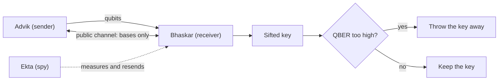

 # Quantum-catching-the-spy-qkd

  ### Catching the Spy: Simulation and Eavesdropper Detection Analysis in BB84 Quantum Key Distribution Networks Using Qiskit

[](https://opensource.org/licenses/MIT)
[](https://www.python.org/)
[](https://pypi.org/project/qiskit/)
[](https://pypi.org/project/qiskit-aer/)
[](#)

This repository simulates the BB84 protocol on a single-qubit circuit model. It runs the protocol twice: once on a clean channel, and once with a spy who measures every qubit and sends a fresh one on to the receiver. The error rate in the shared key (the QBER) is then compared across the two runs, and a key with too many errors is thrown away. A Python-based simulation of the BB84 Quantum Key Distribution (QKD) protocol using IBM's Qiskit. Features a custom software pipeline evaluating secure state preparation, a measure-and-resend eavesdropping attack simulation (featuring Advik, Bhaskar, and Ekta), and quantitative analysis of the Quantum Bit Error Rate (QBER) to abort compromised keys

The three people in the simulation:

| Name | Role | What they do |
|------|------|--------------|
| Advik | Sender | Picks random bits and random bases, and encodes them as qubits |
| Bhaskar | Receiver | Measures each incoming qubit in a randomly chosen basis |
| Ekta | Spy | Measures each qubit on its way, then resends a new one |

## Contents

- [Background](#background)
- [How the pieces fit together](#how-the-pieces-fit-together)
- [Installation](#installation)
- [Usage](#usage)
- [What the simulation does](#what-the-simulation-does)
- [Expected results](#expected-results)
- [Limitations](#limitations)
- [Future work](#future-work)
- [References](#references)
- [License](#license)

## Background

BB84 is a quantum key distribution protocol published by Charles Bennett and Gilles Brassard in 1984. Two people use it to agree on a secret key, even though the qubits travel over a channel that someone else might be watching.

It works because of two facts about quantum states. First, an unknown state cannot be copied exactly (the no-cloning theorem), so a spy cannot keep a perfect copy and also pass the original along. Second, measuring a qubit in the wrong basis changes it, so the spy leaves traces behind.

Qubits are sent in one of two bases, written `+` (computational) and `x` (diagonal). If the sender and receiver happen to choose the same basis, the receiver reads the right bit. If they choose differently, the result is a coin flip. Afterwards they announce their bases in public, without revealing the bits, and keep only the positions where the bases matched. What is left is called the sifted key.

If a spy has been measuring, about one in four of the sifted bits will be wrong. Without a spy, in an ideal channel, none will be.

## How the pieces fit together



There are four steps:

1. Advik makes random bits and random bases, and prepares one qubit per bit.
2. Bhaskar measures each qubit in a random basis. In the attack run, Ekta measures first and resends.
3. Advik and Bhaskar compare their bases over the public channel and keep the matching positions.
4. They compare part of the sifted key, work out the QBER, and decide whether to keep or discard it.

## Installation

You need Python 3.10 or newer.

```bash
git clone https://github.com/<techindro>/quantum-catching-the-spy-qkd.git
cd quantum-catching-the-spy-qkd

python -m venv venv
source venv/bin/activate        # on Windows: venv\Scripts\activate

pip install qiskit qiskit-aer matplotlib numpy
```

## Usage

Run the simulation script from the repository root:

```bash
python qkd_simulation.py
```

It prints the bits, the bases, both sifted keys and the QBER for each run. It also saves two files:

- `qber_comparison_plot.png`, a bar chart of the QBER with and without Ekta
- `quantum_circuit_pipeline.png`, the circuit used for the intercepted run

## What the simulation does

**Clean channel.** Advik flips the qubit with an X gate if his bit is 1, and applies an H gate if he chose the `x` basis. Bhaskar applies an H gate if he chose `x`, then measures. When their bases agree, he gets Advik's bit.

**With Ekta.** Ekta measures in her own random basis, then prepares a new qubit from her result in that same basis. When her basis differs from Advik's, the new qubit no longer carries his bit, so Bhaskar's answer is right only half the time.

**QBER.** Only positions where Advik's and Bhaskar's bases matched are used:

```
QBER = wrong bits in the sifted key / length of the sifted key
```

Research on BB84 puts the limit for safely extracting a key at roughly 11% error. Above that, the key is discarded.

## Expected results

| Run | Expected QBER |
|-----|---------------|
| No spy | 0% |
| With Ekta | about 25% |

> With only 20 qubits the sifted key is about 10 bits long, so the measured numbers jump around a lot from run to run. Use a few hundred qubits or more to get close to the figures above.

## Limitations

- The channel is perfect. There is no photon loss, detector noise or thermal noise.
- Only the measure-and-resend attack is simulated. Other attacks are not covered.
- The public channel is assumed to be authenticated.
- Error correction and privacy amplification are not implemented, so the sifted key is not yet a finished secret key.
- Very short keys give a noisy QBER estimate.

## Future work

- Add channel noise and see how the abort threshold moves.
- Add error correction, for example the Cascade protocol.
- Add privacy amplification.
- Try an entanglement-based version such as E91.

## References

1. C. H. Bennett and G. Brassard, "Quantum cryptography: Public key distribution and coin tossing," *Proceedings of the IEEE International Conference on Computers, Systems and Signal Processing*, Bangalore, 1984, pp. 175-179.
2. W. K. Wootters and W. H. Zurek, "A single quantum cannot be cloned," *Nature* 299, 802-803 (1982).
3. P. W. Shor and J. Preskill, "Simple proof of security of the BB84 quantum key distribution protocol," *Physical Review Letters* 85, 441 (2000).
4. Wikipedia articles used for background reading: [BB84](https://en.wikipedia.org/wiki/BB84), [Quantum key distribution](https://en.wikipedia.org/wiki/Quantum_key_distribution), [No-cloning theorem](https://en.wikipedia.org/wiki/No-cloning_theorem).
5. [Qiskit documentation](https://docs.quantum.ibm.com/)

## License

Released under the [MIT License](https://opensource.org/licenses/MIT).
